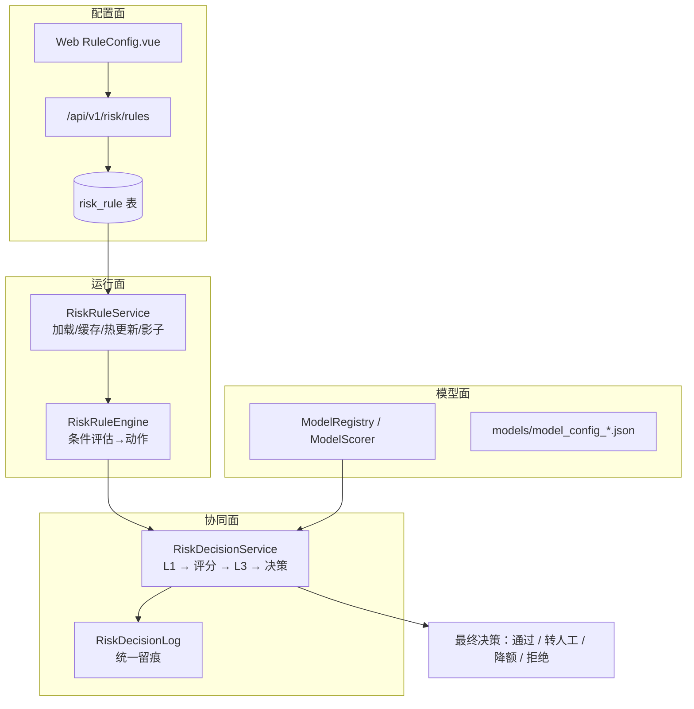

# 风险规则层 · 开发实施文档

> 版本：V1.0（开发指导）
> 目标：把"风险规则层"从**设计**变成**可运行模块**——规则可配置、与评分卡协同、决策可留痕
> 关联文档：`risk-rule-set-design.md`（规则集内容，21 条）、`scorecard-multimodel-api.md`（模型接口）、`多源数据.md`（字段口径）
> 关联计划：《第5周开发计划.md》后续 / W6 阶段

---

## 一、范围与目标

| 阶段 | 内容 | 交付 |
|---|---|---|
| **阶段 1** | 规则可配置：`risk_rule` 表 + 规则服务 + 条件引擎 + CRUD 接口（接通 Web 已有页面） | 管理端能增删改规则并生效 |
| **阶段 2** | 决策编排：`RiskDecisionService` 统一入口（**L1 规则 → 特征/评分 → L3 规则 → 最终决策 + 统一留痕**） | 一个入口出决策，规则与模型协同 |
| **阶段 3**（可选） | 阈值统一治理 + 命中监控面板 + 影子/灰度 | 规则效果可观测 |

**明确不做**：
- 不引入 **Drools**（规则量小、变更不频繁，收益低于维护成本）；条件用**结构化 JSON** 表达
- 不接真实黑名单/征信数据源（沿用现有模拟 Provider 字段）

---

## 二、现状盘点（开工前必读）

| 对象 | 现状 | 影响 |
|---|---|---|
| 规则引擎依赖 | `pom.xml` **无** drools/easy-rules | 需自研轻量条件引擎 |
| 规则表 | **无** `risk_rule` 表 | 需新建 |
| `/risk/rules` 端点 | **后端不存在**；Web `api/index.ts` 已在调用（`getRuleList/createRule/...`）、页面 `RuleConfig.vue` 已存在 | **补齐后端即可接通**，不必改前端 |
| 现有规则逻辑 | `RiskControlUtil.preCheck()` 硬编码 `>=600`；`evaluateScorecard()` 三档判定（阈值来自产品表 `loan_product.auto_pass_score/manual_review_score`） | 作为规则集的**兜底**保留 |
| 决策留痕 | `RiskDecisionLog` + Mapper 已存在（含 `model_version`/`feature_snapshot`） | 复用，建议加 `hit_rules` 列 |
| 特征入参 | `MultiSourceIngestService.featureSnapshot(userId)`（多源特征）、`FeatureTransformationService.buildMultiSourceFeatures(userId)`（基础 6 + 多源，W5-A1 已实现） | 规则引擎**直接复用**，无需新造 |
| 模型路由 | `ModelRegistry` / `ModelScorer`（W4） | 编排层直接调用 |
| 字段白名单/区间 | `MultiSourceIngestServiceImpl` 的 `RANGE_RULES`（含 device/credit/operator/behavior 字段） | 规则条件只允许白名单字段（防注入、防拼错） |

---

## 三、总体架构



| 模块 | 职责 | 状态 |
|---|---|---|
| `RiskRuleService` | 规则 CRUD、加载、**内存缓存**、热更新、影子开关 | 待开发 |
| `RiskRuleEngine` | 条件评估（结构化条件）、动作聚合、优先级与短路 | 待开发 |
| `RiskDecisionService` | **决策编排**：L1 → 特征装配/评分 → L3 → 最终决策 + 留痕 | 待开发（核心） |
| `ModelRegistry` / `ModelScorer` | 模型注册、版本路由、降级、影子 | **已有** |
| `RiskDecisionLog` | 统一留痕 | **已有**（扩展 `hit_rules`） |
| `RiskControlUtil` | 三档阈值兜底 | **已有**（保留） |

---

## 四、数据设计

### 4.1 `risk_rule` 表（新建）

```sql
CREATE TABLE IF NOT EXISTS risk_rule (
  id             BIGINT AUTO_INCREMENT PRIMARY KEY,
  rule_code      VARCHAR(32)  NOT NULL COMMENT '规则编号，如 L1-01',
  rule_name      VARCHAR(64)  NOT NULL COMMENT '规则名称',
  layer          VARCHAR(8)   NOT NULL COMMENT 'L1=前置拦截 L3=后置修正',
  source_type    VARCHAR(32)  NULL     COMMENT '来源：device/behavior/credit/operator/social',
  condition_json TEXT         NOT NULL COMMENT '结构化条件（见 §5.5）',
  action         VARCHAR(24)  NOT NULL COMMENT 'REJECT/MANUAL/DOWNGRADE/FLAG',
  action_param   VARCHAR(64)  NULL     COMMENT '动作参数（如降额比例 50%）',
  priority       INT          NOT NULL DEFAULT 100 COMMENT '数值越小越先执行',
  enabled        TINYINT      NOT NULL DEFAULT 0 COMMENT '1=启用 0=停用（默认停用）',
  shadow_mode    TINYINT      NOT NULL DEFAULT 1 COMMENT '1=只记录不生效（默认影子）',
  remark         VARCHAR(255) NULL,
  create_time    DATETIME     NOT NULL DEFAULT CURRENT_TIMESTAMP,
  update_time    DATETIME     NOT NULL DEFAULT CURRENT_TIMESTAMP ON UPDATE CURRENT_TIMESTAMP,
  UNIQUE KEY uk_rule_code (rule_code),
  KEY idx_layer_enabled (layer, enabled)
) ENGINE=InnoDB DEFAULT CHARSET=utf8mb4 COMMENT='风险规则表';
```

### 4.2 `risk_decision_log` 扩展（可选）

```sql
ALTER TABLE risk_decision_log
  ADD COLUMN hit_rules VARCHAR(512) NULL COMMENT '本次命中的规则编号（逗号分隔）',
  ADD COLUMN rule_action VARCHAR(24) NULL COMMENT '规则层产生的动作';
```

### 4.3 阈值来源优先级（统一治理）

```
规则表 action_param / 配置项  >  产品表(loan_product.*_score)  >  模型配置(model_config.thresholds)
```

> 规则命中时使用的阈值写入留痕，保证"这笔决策为什么用这个线"可回溯。

---

## 五、后端模块设计

### 5.1 RiskRuleService

```java
public interface RiskRuleService {
    List<RiskRule> listAll();                       // 全量（管理端）
    Map<String, List<RiskRule>> loadEnabledRules(); // 启用规则，按 L1/L3 分组（内存缓存）
    RiskRule save(RiskRule rule);                   // 新增/更新（校验 rule_code、字段白名单）
    boolean toggle(String ruleCode, boolean enabled);
    boolean setShadow(String ruleCode, boolean shadow);
    void refreshCache();                            // 配置变更后刷新
}
```

### 5.2 RiskRuleEngine

```java
public interface RiskRuleEngine {
    /**
     * 评估规则集
     * @param layer    L1 / L3
     * @param features 特征快照（复用 featureSnapshot / buildMultiSourceFeatures）
     * @param score    评分（L3 需要；L1 传 null）
     * @param ctx       上下文（申请ID、用户ID、上报事件）
     * @return 命中列表 + 归并后的动作（按优先级短路）
     */
    RuleOutcome evaluate(String layer, Map<String, Object> features, Integer score, RuleContext ctx);
}
```

**执行语义**：
- 按 `priority` 升序执行；**REJECT 命中即短路**（同层后续规则不再评估）；
- 影子规则（`shadow_mode=1`）只记录、不参与动作归并；
- 动作归并优先级：`REJECT > MANUAL > DOWNGRADE > FLAG`；
- 条件字段必须在**白名单**内（`RANGE_RULES` + 基础字段），否则规则加载时即报错。

### 5.3 RiskDecisionService（编排层，核心）

```java
public interface RiskDecisionService {
    /** 统一决策入口：L1 → 特征/评分 → L3 → 最终决策 + 留痕 */
    DecisionResult decide(String applicationId, String userId, Map<String, Object> extra);
}
```

流程：

```
1) 取特征：FeatureTransformationService.buildMultiSourceFeatures(userId)
2) L1 评估：RiskRuleEngine.evaluate("L1", features, null, ctx)
     - REJECT  → 直接拒绝（不评分），写留痕，返回
     - MANUAL  → 标记，继续评分（或按配置跳过评分）
3) 评分：MultiModelScorecardService.calculate(modelVersion=默认, features)
     - 得到 score / decision / missingFeatures / degraded
4) L3 评估：RiskRuleEngine.evaluate("L3", features, score, ctx)
5) 合成最终决策：模型决策 + L3 动作（REJECT/MANUAL/DOWNGRADE/FLAG）
6) 写 RiskDecisionLog：命中规则、模型版本、分数、最终动作、特征快照
```

### 5.4 接口清单

| 方法 | 路径 | 说明 |
|---|---|---|
| GET | `/api/v1/risk/rules` | 规则列表（Web 已按此调用） |
| POST | `/api/v1/risk/rules` | 新建规则 |
| PUT | `/api/v1/risk/rules/{id}` | 更新规则 |
| DELETE | `/api/v1/risk/rules/{id}` | 删除规则 |
| PATCH | `/api/v1/risk/rules/{id}/toggle` | 启用/停用 |
| PATCH | `/api/v1/risk/rules/{id}/shadow` | 影子开关 |
| POST | `/api/v1/risk/rules/evaluate` | **规则试算**（传特征，返回命中与动作，不落库） |
| GET | `/api/v1/risk/rules/stats` | 命中率 / 误杀率 / 覆盖率 |
| POST | `/api/v1/risk/decision` | **统一决策入口**（L1→评分→L3，写留痕） |

> Web 端 `api/index.ts` 现有调用为 `getRuleList/createRule/updateRule/deleteRule/toggleRule`（路径 `/risk/rules`），**前端无需改动**。

### 5.5 条件表达式格式（结构化，不执行脚本）

```json
{
  "and": [
    { "field": "device_related_app_cnt_30d", "op": ">=", "value": 5 },
    { "field": "device_multi_account_now",   "op": "=",  "value": 1 }
  ]
}
```

- `op` 支持：`= != > >= < <= in`；
- 组合：`and` / `or` 可嵌套；
- `field` 必须命中白名单（`RANGE_RULES` ∪ 基础特征 ∪ `score` / `applicationId` / `userId`）；
- **不引入脚本引擎**（避免注入风险与运维负担）。

---

## 六、前置依赖与缺口

| 依赖 | 现状 | 影响的规则 |
|---|---|---|
| `social_*` 字段 | 未接入（Provider 占位） | L3-08 暂不可用（规则可先建但停用） |
| `field_count` | App 上报传 `0` | L1-07 需 App 侧补真实统计 |
| `form_fill_ms` | App 已上报（填表埋点） | L1-07 可用 |
| `gps_addr_distance_once` | 未实现（需地理编码） | 位置类规则用 `gps_deviation_km_longterm` 替代 |
| `ip_proxy_risk` / `ip_geo_mismatch` | 字段存在 | L1-04/L1-05 可用 |
| 黑名单数据 | 模拟 Provider 字段 | L1-02 依赖模拟数据（如实声明） |

---

## 七、分阶段实施清单

### 阶段 1 · 规则可配置（建议先做）

- [ ] 执行 §4.1 DDL（`risk_rule`），插入 `risk-rule-set-design.md` 的 21 条规则（默认 `enabled=0, shadow_mode=1`）
- [ ] 新增 `entity/RiskRule` + `mapper/RiskRuleMapper`(+XML)
- [ ] 实现 `RiskRuleService`（CRUD + 内存缓存 + 热更新 + 校验白名单）
- [ ] 实现 `RiskRuleEngine`（结构化条件评估 + 优先级短路 + 影子过滤）
- [ ] 新增 `RiskRuleController`（§5.4 的 8 个规则端点，**路径与 Web 调用一致**）
- [ ] 单测：条件评估（and/or/各 op）、优先级短路、影子过滤、非法字段拒绝
- [ ] 联调：Web `RuleConfig.vue` 增删改查通
- [ ] 回归：`mvnw test` 全绿

### 阶段 2 · 决策编排（核心）

- [ ] 实现 `RiskDecisionService.decide()`（L1 → 评分 → L3 → 最终决策）
- [ ] 接入 `LoanApplicationServiceImpl`（申请提交链路调用统一入口，替代当前直接评分）
- [ ] `RiskDecisionLog` 扩展 `hit_rules` / `rule_action`，编排层统一写入
- [ ] 单测：L1 命中拒绝（不评分）、L3 命中降额、无命中走模型决策、留痕完整性
- [ ] 端到端冒烟（curl）：L1 拒绝 / 评分 / L3 降额 三条路径 + 留痕校验
- [ ] 回归：既有评分与审批链路行为不变（v3 兼容用例保持通过）

### 阶段 3（可选）

- [ ] 阈值统一治理（规则/产品/模型阈值优先级 + 留痕）
- [ ] `/risk/rules/stats`：命中率 / 误杀率 / 覆盖率（供 Web 面板）
- [ ] 影子运行 → 灰度启用流程（先 `shadow_mode=1` 跑 2–4 周）

---

## 八、验证与回归

```powershell
# 后端
cd D:\code\loan
.\mvnw.cmd test                          # 含规则引擎与编排单测
.\mvnw.cmd spring-boot:run

# 规则管理（Web 已按这些路径调用）
curl.exe -s "http://127.0.0.1:8080/api/v1/risk/rules" -H "Authorization: Bearer <token>"
curl.exe -s -X POST "http://127.0.0.1:8080/api/v1/risk/rules/evaluate" -H "Authorization: Bearer <token>" `
  -H "Content-Type: application/json" -d '{\"features\":{\"device_emulator_flag\":1}}'
curl.exe -s -X POST "http://127.0.0.1:8080/api/v1/risk/decision" -H "Authorization: Bearer <token>" `
  -H "Content-Type: application/json" -d '{\"applicationId\":\"APP-RULE-001\",\"userId\":\"<uid>\"}'

# Web
cd D:\code\vue-loan-project\vue-loan-project
node .\node_modules\vite\bin\vite.js build   # npm run build 受既有类型错误影响，见下
```

**必须验证的四条路径**：
1. L1 命中 `REJECT` → 拒绝且**不进入评分**；
2. L1 未命中 → 正常评分 → 模型决策；
3. L3 命中 `DOWNGRADE` → 决策降额、**分数不变**；
4. 全程 `risk_decision_log` 有记录（含 `hit_rules` / `model_version` / 分数）。

---

## 九、风险与对策

| 风险 | 影响 | 对策 |
|---|---|---|
| 规则误杀正常客户 | 业务损失 | **组合条件**（单条件只 FLAG）+ **先影子运行** + 误杀率监控（阈值 >20% 触发复核） |
| 条件表达式注入 | 安全 | **结构化 JSON** + 字段白名单；不执行脚本 |
| 规则与模型阈值冲突 | 决策口径不一致 | 明确优先级（§4.3）并**写入留痕**；管理端提示 |
| 规则集加载性能 | 评分延迟 | 内存缓存 + 变更刷新；L1 短路求值 |
| 与既有链路耦合过深 | 回归风险 | 保留 `RiskControlUtil` 兜底；`LoanApplicationServiceImpl` 仅替换决策入口，不删原逻辑 |
| 前端规则页受既有类型错误影响 | 构建失败 | 已知 6 处既有类型错误（`ApplicationDetail.vue` / `OverdueStats.vue`），规则页本身不涉及；构建用 `vite build` 验证 |

---

## 十、命令速查

```powershell
# 建表
& "D:\Program Files\MySQL\MySQL Server 8.0\bin\mysql.exe" --host=127.0.0.1 --port=3306 `
  --user=root --database=loan_risk_control --execute="source db/risk_rule_schema.sql"

# 后端
cd D:\code\loan
.\mvnw.cmd test
.\mvnw.cmd spring-boot:run
```

---

## 十一、与 W6 的衔接

| W6 任务 | 本文档提供 |
|---|---|
| 全链路联调 | 统一决策入口 `POST /api/v1/risk/decision`（L1→评分→L3） |
| 决策一致性校验 | 留痕 `hit_rules` + `model_version` + 特征快照可回溯 |
| 安全与合规自查 | 结构化条件 + 字段白名单 + 影子运行，规避注入与误杀 |
| 验收报告 | 规则命中率/误杀率指标（阶段 3 面板） |

---

## 十二、实施状态（本次实施结果）

### 阶段 1 · 规则可配置 —— ✅ 已完成并端到端验证

| 项 | 结果 |
|---|---|
| `risk_rule` 表 + 初始规则集 | ✅ `db/risk_rule_schema.sql`：**12 条**（L1×7 / L3×4 / F×1），默认 `enabled=0` + `shadow_mode=1` |
| 规则引擎 `RiskRuleEngine` | ✅ **受限表达式 DSL**（`field op value [AND\|OR ...]`，不执行脚本）+ **字段白名单（含别名）** + 优先级短路 + 影子过滤 + 动作归并（`REJECT>MANUAL>DOWNGRADE>FLAG`）+ 中文动作归一化 + 缺失值保守不命中 |
| 规则服务 `RiskRuleService(+Impl)` | ✅ CRUD / 启停 / 影子开关 / **规则试算** / 元信息（字段白名单） |
| 规则接口 `RiskRuleController` | ✅ **8 个端点，路径与 Web 既有调用完全一致**（`/api/v1/risk/rules`）→ 补齐"前端有页面、后端无接口"缺口 |
| 单测 `RiskRuleEngineTest` | ✅ **10 例**：AND/OR 语义、数值/字符串比较、**字段别名**、缺失值保守、REJECT 短路、影子不过滤动作、动作归并、白名单校验、中文动作 |

**端到端实测（7 步全通过）**：
列表 12 条 → 试算（默认停用）`hitCount=0` → 启用 L1-01 → 试算**命中但影子**（`hitCount=1, action=空`）→ 关闭影子 → 试算 **`action=REJECT`** → 非法字段被拒（`code=400 条件使用了不支持的字段`）→ 恢复初始状态。

**单测发现的 2 个真实缺陷（已修）**：
1. 别名（`creditScore`）被白名单拒绝 → 白名单改为同时接受别名；
2. 正则回溯歧义：`"score >= "`（值缺失）被解析成 `score > "="` 而漏过校验 → 收紧 value 为 `[^=<>!\s].*`。

### 阶段 2 · 决策编排 —— ✅ 已完成并端到端验证

| 项 | 结果 |
|---|---|
| `RiskDecisionService(+Impl)` | ✅ **L1 规则 → 特征装配 → 评分 → 产品阈值基准决策 → L3 规则（只改动作不改分数）→ 统一留痕** |
| 接口 | ✅ `POST /api/v1/risk/decision`（**独立入口**，不替换既有申请链路，避免回归） |
| 实测 | `featureCount=24 → score=735（v4）→ base=AUTO_PASS（产品阈值 643/563·**PRODUCT**）→ L3 命中 → **final=MANUAL_REVIEW**`；留痕含 `applied_auto_pass/applied_manual_review/threshold_source/product_id/命中规则` |
| 修复 | 初版**重复留痕**（评分服务 + 编排层各写一条）→ 编排层调用评分时**不再传 applicationId**，留痕统一由编排层写入（复验 `log_count=1`） |

**编排价值演示**：模型给出 `AUTO_PASS`（分数 735 ≥ 产品阈值 643），但 L3 规则命中"分数达标但风险标签异常"→ 最终决策被修正为 **转人工**，且**分数不变**（保持模型权威）。

### 阶段 3 · 命中统计 —— ✅ 后端已完成（面板与迁移机制待做）

| 项 | 结果 |
|---|---|
| `risk_rule_hit_log` 表 | ✅ 命中流水（`application_id` / `rule_id` / `rule_code` / `layer` / `action` / `shadow` / `hit_time`） |
| 编排层写入 | ✅ `RiskDecisionService` 写留痕时**同步记录命中流水**（L1 + L3 各自的命中项） |
| 统计接口 | ✅ `GET /api/v1/risk/rules/stats`：总体概览 / 各规则命中 / 层×动作分布 / **近似误杀率**（命中且最终审批通过的占比，需申请单关联）/ 最近命中 |
| 实测 | 触发一次命中后：`overview={"totalHits":1,"shadowHits":0,"involvedApplications":1,"distinctRules":1}`；`byRule` / `byLayerAction`（`L3×MANUAL=1`）/ `recent` 均有数据 |

**仍待做**：Web 端统计面板、规则 ↔ 模型迁移机制（漂移特征降级 / 稳定规则转正）、影子→启用的灰度流程。

### 与既有链路的关系

- `RiskRuleController` 路径与 Web `api/index.ts` 既有调用**完全一致** → 前端规则页现在可直接使用；
- `RiskDecisionService` 为独立入口，`LoanApplicationServiceImpl` 保持原行为（**零回归**，测试 36/36 全绿）。

---

**文档结束**
