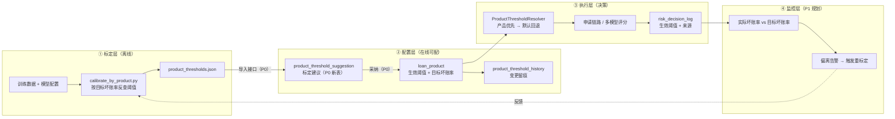

# 阈值治理功能 · 完整设计与实施文档

> 版本：V1.0
> 定位：把"评分阈值"从**人工拍数字**升级为**可标定、可配置、可追溯、可回归**的治理闭环
> 关联：`product-threshold-development-guide.md`（阈值分化开发文档）、`scorecard-multimodel-api.md`（模型与默认阈值）、`risk-rule-set-design.md`（L3 规则修正）
> 实施状态：**P0 已完成并端到端验证**；P1–P4 为规划项

---

## 一、治理闭环总览



**核心分工**：
- **分数刻度全平台统一**（同一模型版本）→ 分数可比；
- **阈值按产品分化**（不同产品风险容忍度不同）；
- **标定在离线、配置在在线、执行在链路、监控在闭环**。

---

## 二、现状盘点

### 2.1 已实现（P0 及之前）

| 层 | 能力 | 位置 |
|---|---|---|
| 标定 | 按产品/目标坏账率标定脚本 | `scorecard_project/scripts/calibrate_by_product.py` → `outputs/v4/product_thresholds.csv/json` |
| 配置 | 产品级阈值 + 目标坏账率 + 来源 + 更新时间 | `loan_product`（4 个扩展字段） |
| 配置 | 保存校验（成对配置 / 300–950 / `manual ≤ auto`） | `LoanProductServiceImpl.validateThresholds()` |
| 配置 | 阈值变更留痕 | `product_threshold_history` |
| **配置** | **标定建议落库 + 查询 + 采纳（P0）** | `product_threshold_suggestion` + `ThresholdGovernanceService/Controller` |
| 执行 | 阈值解析（产品优先 → 默认回退 → `manual ≤ auto` 防御） | `scorecard/ProductThresholdResolver` |
| 执行 | 决策留痕记录生效阈值与来源 | `risk_decision_log`（`applied_auto_pass` / `applied_manual_review` / `threshold_source` / `product_id`） |
| 展示 | Web 产品页：目标坏账率、阈值来源、**标定建议卡片（P0）** | `ProductDetail.vue` + `components/ThresholdSuggestionCard.vue` |

### 2.2 尚未实现（规划项）

| 编号 | 缺口 | 影响 |
|---|---|---|
| **P1** | 实际表现回归（决策 → 还款结果 → 按产品算实际坏账率 vs 目标） | 阈值无自我纠偏能力，客群漂移后不报警 |
| **P2** | 按额度/渠道分档阈值 | 大额敞口未受更严门槛保护 |
| **P3** | 分产品模型适用性报告（AUC/KS/PSI）+ 必要时分数重标定 | "共用模型 + 分产品阈值"缺少逐产品证据 |
| P4 | 申请链路记录 `model_version`（当前为 NULL） | 阈值与模型版本无法绑定，跨版本不可迁移 |

---

## 三、数据设计

| 表 | 用途 | 关键字段 |
|---|---|---|
| `loan_product` | 生效阈值（产品级） | `auto_pass_score`、`manual_review_score`、`target_bad_rate`、`target_pass_rate`、`threshold_source`、`threshold_updated_at` |
| `product_threshold_history` | 阈值变更留痕 | `product_id`、`auto_pass_score`、`manual_review_score`、`threshold_source`、`change_reason`、`changed_by` |
| **`product_threshold_suggestion`**（P0 新增） | 标定建议 | `suggested_auto_pass`、`suggested_manual_review`、`target_bad_rate`、`expected_bad_rate`、`expected_pass_rate`、`sample_size`、`calibrated_at`、`note`、`adopted`、`adopted_at` |
| `risk_decision_log` | 决策留痕 | `product_id`、`applied_auto_pass`、`applied_manual_review`、`threshold_source`、`model_version`、`feature_snapshot` |

**字段语义（硬约束）**：
- `auto_pass_score`：分数 ≥ 该值 → 自动通过（300–950）
- `manual_review_score`：分数 ≥ 该值且 < 自动通过线 → 转人工；否则拒绝（**必须 ≤ auto**）
- `threshold_source`：`MANUAL`（人工）/ `CALIBRATED`（标定采纳）/ `DEFAULT`（全局默认回退）

**阈值优先级**：`产品配置（PRODUCT/CALIBRATED） > 全局默认（DEFAULT，650/600）`，且**写入留痕**。

---

## 四、接口清单

### 4.1 产品与阈值（已有，部分本系列新增）

| 方法 | 路径 | 说明 |
|---|---|---|
| GET | `/api/v1/products/{id}` | 产品详情（含阈值、目标坏账率、来源） |
| PUT | `/api/v1/products/{id}` | 更新产品（含阈值；服务端校验） |

### 4.2 阈值治理（P0 新增）

| 方法 | 路径 | 说明 |
|---|---|---|
| POST | `/api/v1/threshold/suggestions/import` | **导入标定建议**（供离线脚本回传） |
| GET | `/api/v1/threshold/{productId}/suggestion` | **查询建议**（当前 vs 建议 + 差值 `alreadyAdopted` / `autoPassDelta` / `manualReviewDelta`） |
| POST | `/api/v1/threshold/{productId}/suggestion/adopt?reason=` | **采纳建议**（写入产品配置 + 变更历史 + 标记已采纳） |

### 4.3 规划接口（P1–P3）

| 方法 | 路径 | 说明 |
|---|---|---|
| GET | `/api/v1/threshold/{productId}/performance` | 实际坏账率 vs 目标（P1） |
| POST | `/api/v1/threshold/{productId}/recalibrate` | 触发重标定（P1） |
| GET | `/api/v1/threshold/{productId}/model-fit` | 分产品模型适用性（AUC/KS/PSI，P3） |

---

## 五、P0 实施说明（本次交付）

### 5.1 链路

```
离线标定（calibrate_by_product.py）
   → POST /threshold/suggestions/import（落 product_threshold_suggestion）
   → GET  /threshold/{productId}/suggestion（管理端展示"当前 vs 建议"）
   → POST /threshold/{productId}/suggestion/adopt（写入 loan_product + 写 history + 标记 adopted）
```

### 5.2 实测记录（端到端，真实数据）

**① 导入 3 条标定建议**
```
{"code":200,"data":{"imported":3}}
```

**② 查询建议（房贷）**
```
current   = 700/620，source=MANUAL
suggested = 684/630，target=0.0150，expBad=0.0151，expPass=0.5827
diff      = {"alreadyAdopted":false,"autoPassDelta":-16,"manualReviewDelta":10}
```
> 差值显示"建议比当前更松 16 分"——直观体现"手工阈值偏严"。

**③ 采纳建议**
```
{"productId":"product_14c58091fec1","autoPassScore":684,"manualReviewScore":630,
 "thresholdSource":"CALIBRATED","adoptedSuggestionId":3,
 "expectedBadRate":0.0151,"expectedPassRate":0.5827}
```

**④ 落库校验**

| 表 | 结果 |
|---|---|
| `loan_product` | `684 / 630`，`target_bad_rate=0.0150`，**`threshold_source=CALIBRATED`**，`threshold_updated_at` 已更新 ✅ |
| `product_threshold_history` | 新增：`684 / 630 / CALIBRATED / 按目标坏账率1.5%标定采纳` ✅ |
| `product_threshold_suggestion` | `adopted=1`，`adopted_at` 已写入 ✅ |

### 5.3 关键设计点

1. **建议与生效分离**：建议存在独立表（可多次标定、保留历史），**采纳才写入产品配置**，避免"标定结果自动生效"带来的风险；
2. **采纳即留痕**：采纳写入 `product_threshold_history`（`source=CALIBRATED`），与手工修改（`MANUAL`）区分；
3. **防御一致**：导入时与采纳后都保证 `manual ≤ auto`（与产品校验同一口径）；
4. **业务零侵入**：新增接口独立于既有产品 CRUD，Web 用独立组件（`ThresholdSuggestionCard.vue`）接入，不影响产品页原有逻辑。

---

## 六、P1–P4 规划

| 编号 | 内容 | 关键设计 | 前置条件 |
|---|---|---|---|
| **P1** | 实际表现回归与告警 | `risk_decision_log`（分数/阈值）join 还款结果 → 按产品算实际坏账率 → 与 `target_bad_rate` 比对，偏离超阈值（如 +50%）告警并建议重标定 | 需打通"申请 → 借据 → 还款"链路；样本量充足（建议 ≥ 数百笔带结果申请） |
| **P2** | 额度分档阈值 | 新增 `product_threshold_band`（`product_id` + `min_amount`/`max_amount` + 阈值），`ProductThresholdResolver` 按申请金额选档 | 产品支持额度分档的业务确认 |
| **P3** | 分产品模型适用性 | 按产品客群分别算 AUC/KS/PSI；显著不达标时做**分数重标定**（`score' = a·score + b`）或单独建模 | 各产品真实样本 |
| **P4** | 记录模型版本 | 申请链路改走 `MultiModelScorecardService`（或在单模型路径补 `modelVersion`） | 无（低成本） |

---

## 七、验证与回归

```powershell
# 后端
cd D:\code\loan
.\mvnw.cmd test                      # 26/26 通过（含 ProductThresholdResolverTest）

# P0 链路（需先启动后端）
curl.exe -s -X POST "http://127.0.0.1:8080/api/v1/threshold/suggestions/import" -H "Authorization: Bearer <token>" `
  -H "Content-Type: application/json" -d "[{\"productId\":\"product_001\",\"suggestedAutoPass\":643,\"suggestedManualReview\":563}]"
curl.exe -s "http://127.0.0.1:8080/api/v1/threshold/product_001/suggestion" -H "Authorization: Bearer <token>"
curl.exe -s -X POST "http://127.0.0.1:8080/api/v1/threshold/product_001/suggestion/adopt?reason=test" -H "Authorization: Bearer <token>"

# Web
cd D:\code\vue-loan-project\vue-loan-project
node .\node_modules\vite\bin\vite.js build    # 通过（npm run build 受既有类型错误影响）

# 离线标定
cd D:\code\scorecard_project
python scripts/calibrate_by_product.py --targets "product_001:0.03,product_0d80dcfe84e5:0.06,product_14c58091fec1:0.015"
```

**P0 必须验证的 5 条**：
1. 导入建议成功（`imported = N`）；
2. 查询返回"当前 + 建议 + 差值"；
3. 采纳后产品阈值更新且 `threshold_source=CALIBRATED`；
4. 变更历史新增一条（含 reason）；
5. 建议记录标记 `adopted=1`。

---

## 八、已知边界（如实声明）

| 边界 | 说明 |
|---|---|
| 标定分层为**模拟** | 训练数据无 `product_id`，`calibrate_by_product.py` 用客群画像模拟分层；**上线前须用真实各产品样本重标定** |
| 线上样本不足以实时标定 | 目前"分数"在 `risk_decision_log`、"表现"在还款表，未打通且样本极少（个位数），因此**标的只在离线做**（P1 才有实时回归） |
| 全局默认阈值硬编码 | `ProductThresholdResolver` 的默认 650/600 与 v3 配置一致；切默认模型时需同步（P4 可改为读取模型配置） |
| 申请链路未记模型版本 | 实测 `model_version=NULL`（单模型入口），P4 修复 |

---

## 九、与其它文档的衔接

| 文档 | 关系 |
|---|---|
| `product-threshold-development-guide.md` | 本文档覆盖并扩展其阶段 1/2，把"试算接口"以 **P0 落库+采纳**形式落地 |
| `scorecard-multimodel-api.md` | 模型配置 `thresholds` 的定位=全局默认（兜底），与本文档优先级一致 |
| `risk-rule-development-guide.md` / `risk-rule-set-design.md` | 阈值决定基准档位，L3 规则在其上做修正（转人工/降额） |
| `scorecard_project/development/model-training-plan-v4.md` | 阈值标定方法（按目标坏账率）出处，本文档将其产品化 |

---

**文档结束**
